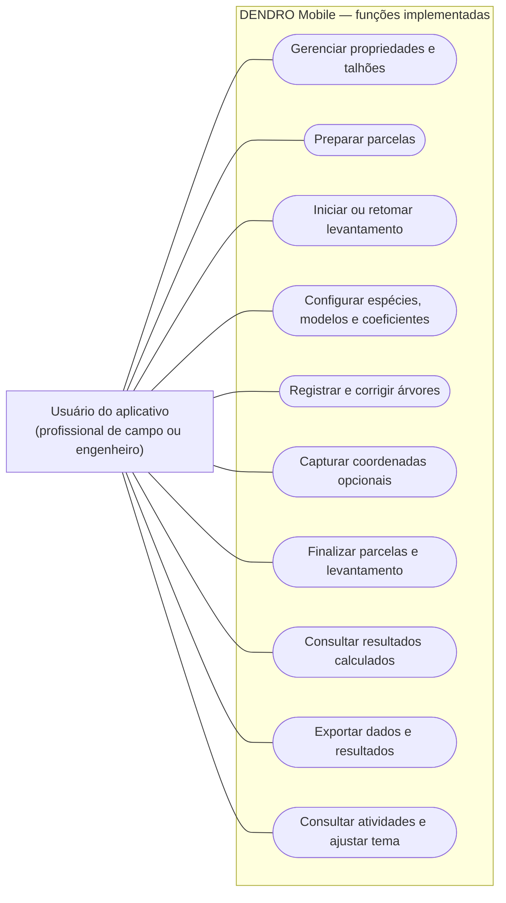
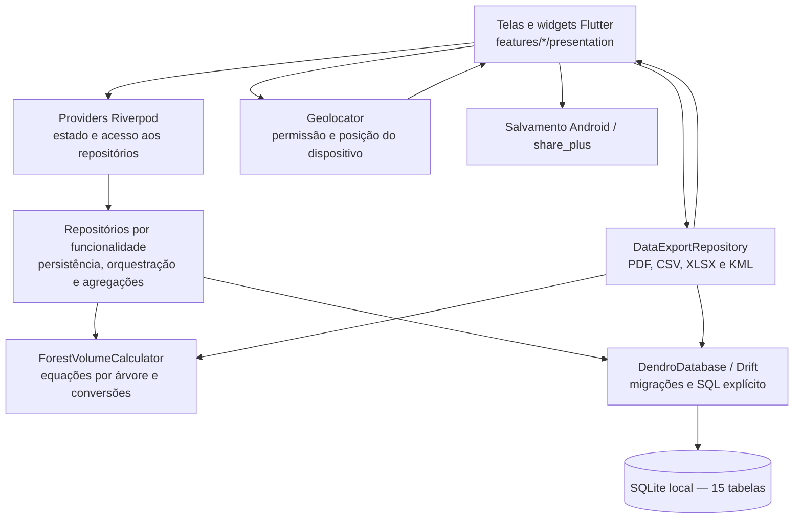
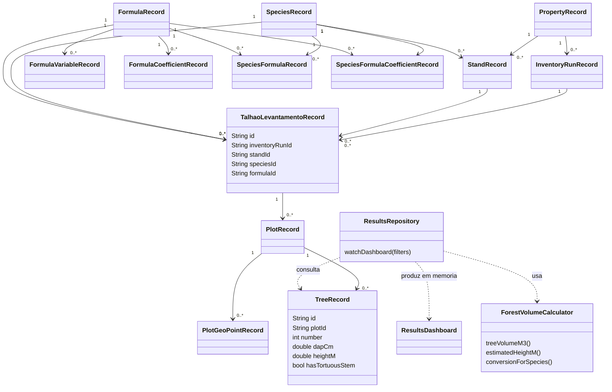
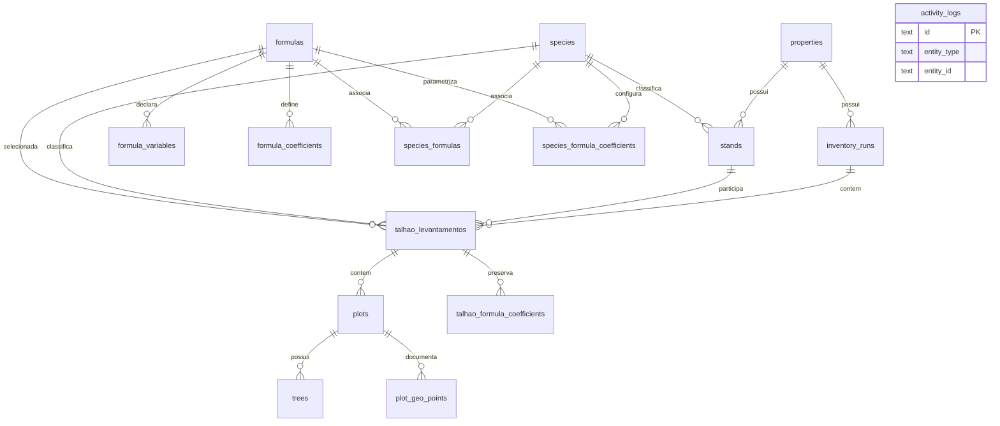
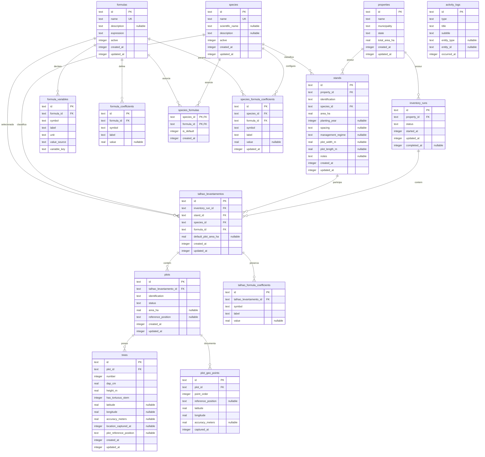
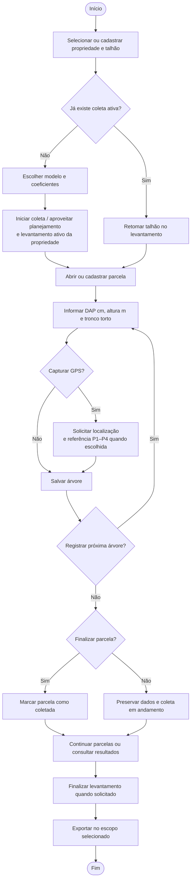
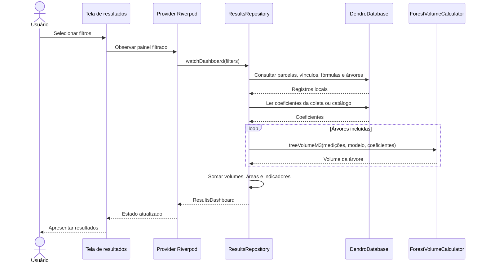
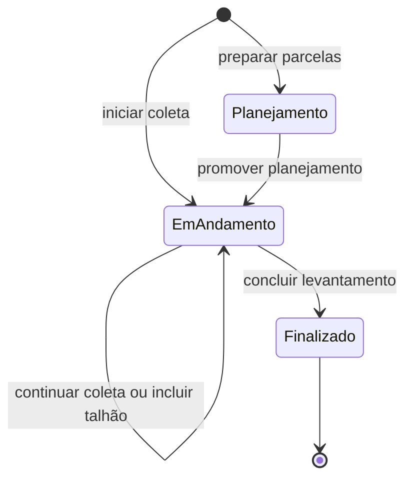

# Modelos de engenharia da versão implementada

Revisão em 13/09/2026, código-base ce282bb. Substitui os diagramas conceituais anteriores. Fontes editáveis estão em diagrams/. Os diagramas representam código e persistência atuais; não certificam validação científica ou ensaios com usuários.

## 1. Atores e funções

Não há autenticação ou perfis distintos. Usuário de campo e engenheiro têm acesso às mesmas funções; a responsabilidade técnica é externa às permissões do software.

O gráfico abaixo é uma visão funcional em Mermaid, não uma notação UML formal de casos de uso. As linhas indicam associação ao usuário, sem sugerir include/extend ou ordem obrigatória. Para UML formal, manter esse escopo ao redesenhar ator, fronteira e elipses.

Casos de uso entregues e rastreabilidade:

| Caso | Descrição | Requisitos |
|---|---|---|
| UC-001 | Cadastrar, consultar, editar e excluir propriedade; disponível também em Novo levantamento | RF-001 |
| UC-002 | Gerenciar talhões da propriedade e dimensões de parcela | RF-002 |
| UC-003 | Iniciar levantamento, escolher modelo/coeficientes e aproveitar planejamento/levantamento ativo da propriedade | RF-017 |
| UC-004 | Retomar talhão em coleta pelo Início ou Levantamentos | RF-018 |
| UC-005 | Preparar e gerenciar parcelas; acompanhar status | RF-003, RF-015 |
| UC-006 | Registrar, editar e excluir árvores com DAP/altura e sequência Salvar/Próxima | RF-004, RF-005, RF-012 |
| UC-007 | Capturar localização opcional da árvore e associar referência P1–P4 | RF-020 |
| UC-008 | Gerenciar espécies, vínculos e modelo padrão | RF-006 |
| UC-009 | Cadastrar modelos e configurar coeficientes; sem parser de expressões arbitrárias | RF-007 parcial, RF-008 |
| UC-010 | Calcular volumes ao consultar resultados, com os modelos reconhecidos pela calculadora | RF-009 |
| UC-011 | Filtrar e consultar painel | RF-010, RF-021 |
| UC-012 | Selecionar escopo e exportar PDF, CSV, XLSX ou variantes brutas | RF-016 |
| UC-013 | Exportar KML com coordenadas disponíveis | RF-016, RF-020 |
| UC-014 | Finalizar parcela e concluir levantamento por ações próprias | RF-015, RF-017 |
| UC-015 | Consultar histórico de atividades e alterar tema | Funções auxiliares implementadas |

Não incluir estimativa econômica, parser genérico, sincronização ou KMZ como casos entregues. Captura GPS é opcional e não uma etapa obrigatória de registrar árvore.

## 2. Arquitetura efetiva

Telas/providers acessam repositórios. O banco usa Drift e SQL explícito; repositórios agregam dados. A calculadora por árvore é separada, enquanto geração de arquivos e agregações de relatório estão no exportador. GPS é solicitado pela tela de coleta; não há GeolocationService separado. Não desenhar camadas Application/Domain inexistentes nem bibliotecas apenas planejadas.

## 3. Modelo de classes de dados

São nomes reais de registros gerados pelo Drift e de classes de cálculo/resultados, com atributos selecionados. Não são entidades de domínio com métodos fictícios concluir()/reabrir(). Ações de persistência ficam nos repositórios. As duas tabelas SQL explícitas (coeficientes da coleta e atividades) são representadas integralmente no modelo do banco, não como registros Drift gerados.

## 4. Relacionamentos do banco

Cada filho das ligações acima possui uma chave estrangeira obrigatória para exatamente um pai; o pai pode ter zero ou muitos filhos. A representação é estrutural: um levantamento criado pela interface normalmente tem talhão, mas a cardinalidade mínima de filhos não é imposta por uma FK.

activity_logs é independente: entity_type/entity_id são referências lógicas opcionais, sem FK. Não desenhar uma FK inexistente. species_formula_coefficients possui FKs independentes para species e formulas, não uma FK composta para species_formulas.

## 5. Modelo físico completo — 15 tabelas

Fonte: classes Table e comandos CREATE TABLE em dendro_database.dart, schemaVersion 9. IDs textuais, números reais, booleanos armazenados como inteiros, enums como texto e datas no armazenamento inteiro padrão do Drift. “nullable” identifica campo opcional.

### Chaves e restrições compostas

- properties: PK id.
- species e formulas: PK id, nome único.
- species_formulas: PK composta (species_id, formula_id).
- stands: UNIQUE(property_id, identification).
- talhao_levantamentos: UNIQUE(inventory_run_id, stand_id).
- plots: UNIQUE(talhao_levantamento_id, identification).
- trees: UNIQUE(plot_id, number).
- plot_geo_points: UNIQUE(plot_id, point_order).
- formula_variables e formula_coefficients: UNIQUE(formula_id, symbol).
- species_formula_coefficients: UNIQUE(species_id, formula_id, symbol).
- talhao_formula_coefficients: UNIQUE(talhao_levantamento_id, symbol).
- Todas as demais tabelas usam PK id; activity_logs não possui FK.

As FKs declaram CASCADE, exceto stands.species_id e talhao_levantamentos.species_id/formula_id, que declaram RESTRICT. Essa descrição é do esquema; repositórios também executam exclusões explícitas. Não afirmar que constraints sozinhas cobrem toda regra de interface.

talhao_formula_coefficients e activity_logs são criadas por SQL nas rotinas de criação/migração, além das 13 tabelas de @DriftDatabase. ResultadoInventario, Measurements e VolumeModel não são tabelas adicionais. DAP/altura ficam em trees; o catálogo volumétrico fica em formulas.

## 6. Fluxo operacional

Este é um percurso de uso, não uma regra que obrigue finalizar tudo antes de consultar/exportar: o aplicativo permite resultados e exportação com coleta em andamento. As etapas acadêmicas da pesquisa devem ser representadas em outro fluxograma, baseado na metodologia efetivamente executada do artigo.

## 7. Sequência de consulta de resultados

A sequência usa componentes reais. O stream da consulta acompanha dados locais; o painel agrega registros compatíveis com os filtros. A exportação tem escopo próprio, conforme REQUIREMENTS.md.

## 8. Estados

Os nomes persistidos são planning, inProgress e completed. O diagrama mostra o percurso de criação/coleta/conclusão, omitindo exclusões e rotinas de normalização. Não inclui reabertura futura como função implementada.

Parcelas têm pending, inProgress e collected. A gravação de árvores e a finalização de parcela são ações separadas; status da parcela e do levantamento não são uma única máquina de estados.

## 9. Uso das figuras no artigo

A visão de relacionamentos é mais legível no corpo do artigo; o modelo com todos os atributos pode ser apêndice ou dividido em coleta e catálogos. Manter nomes/cardinalidades ao redesenhar. Legendas sugeridas: “Funções implementadas do DENDRO Mobile”, “Arquitetura da aplicação” e “Modelo de dados da aplicação”. Indicar elaboração própria com base na implementação.

Para descrever resultados, observar as limitações em BUSINESS_RULES.md: fórmulas genéricas não interpretadas, valores padrão, ausência de estimativa econômica, escopos históricos distintos e validação acadêmica pendente.
