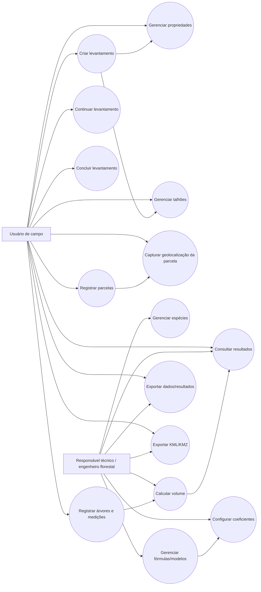
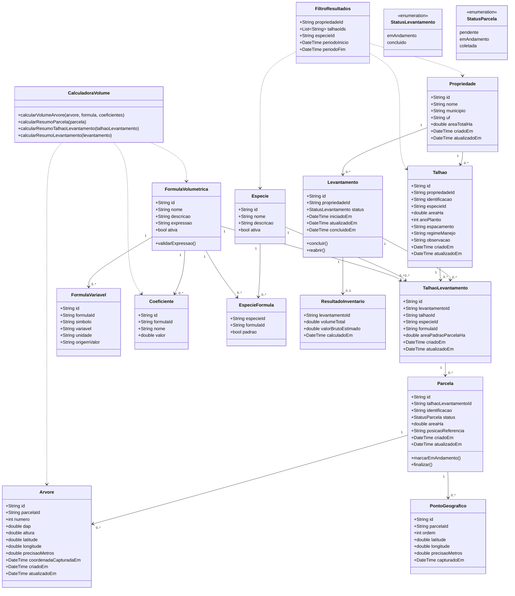
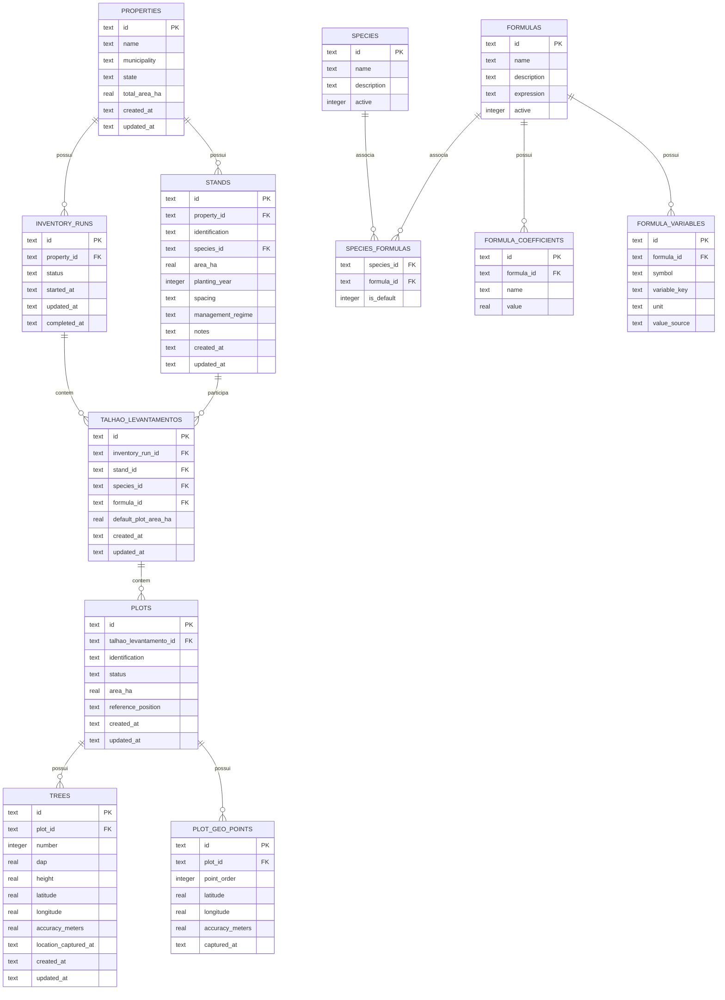
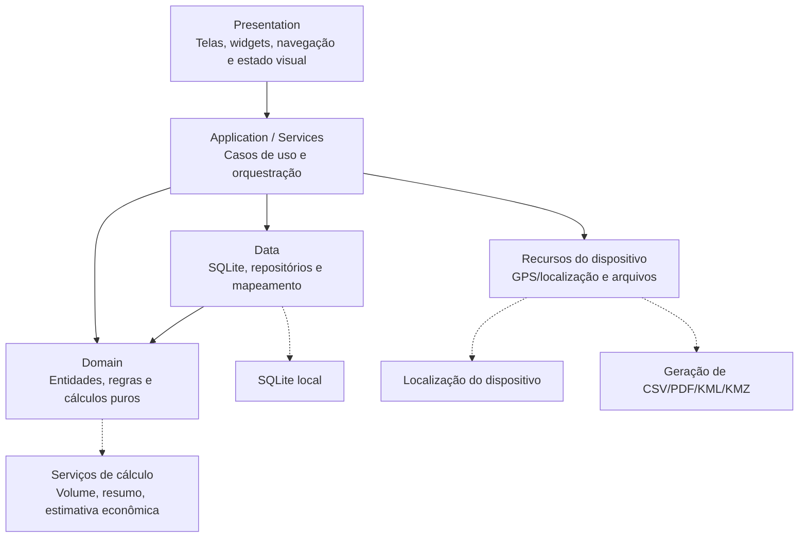
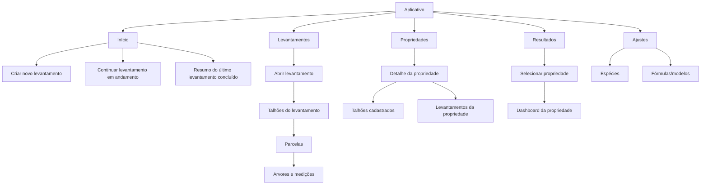
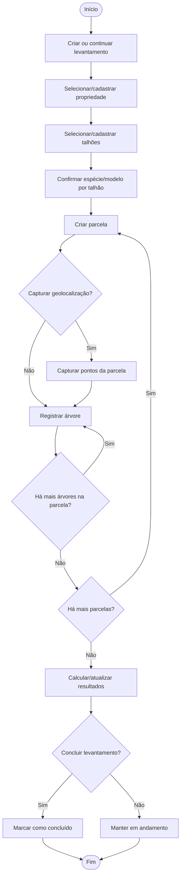
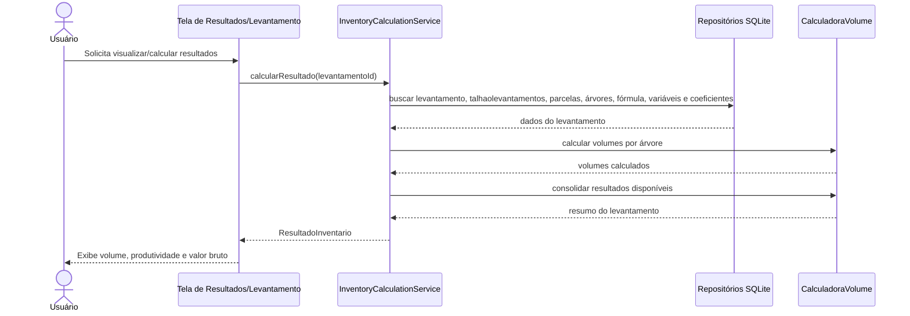
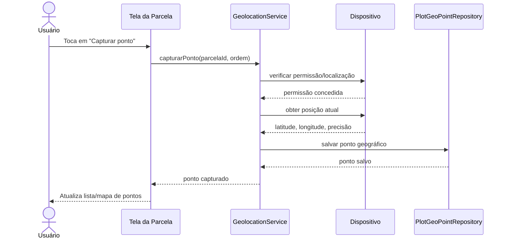
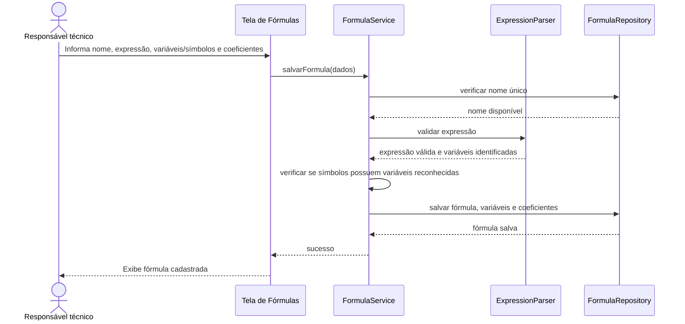
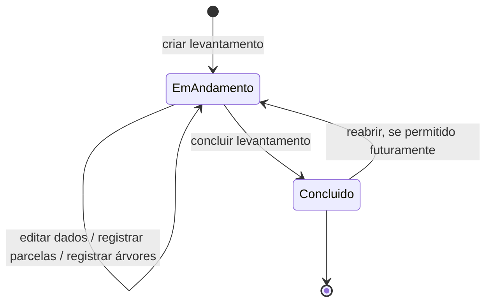

# ENGINEERING_MODELS.md

Modelos iniciais de engenharia do sistema, derivados do contexto, requisitos, regras de negócio e decisões atuais do projeto.

Estes modelos servem como base para o TCC e podem ser refinados conforme o desenvolvimento avance e as regras técnicas de inventário florestal sejam validadas.

## 1. Visão Geral dos Atores

### Usuário de campo
Pessoa que utiliza o aplicativo durante o levantamento para cadastrar propriedade/talhão, registrar parcelas, árvores, medições e pontos de geolocalização.

### Responsável técnico / engenheiro florestal
Pessoa responsável por validar fórmulas, coeficientes, método de amostragem, resultados e documentação final do inventário.

Na primeira versão do sistema não haverá autenticação nem perfis separados. A distinção dos atores é conceitual para documentação dos casos de uso.

## 2. Diagrama de Casos de Uso

## 3. Casos de Uso Textuais

### UC-001 — Gerenciar propriedades
**Ator principal:** Usuário de campo.

**Objetivo:** Cadastrar, visualizar, editar, excluir e pesquisar propriedades.

**Fluxo principal:**
1. O usuário acessa a aba Propriedades.
2. O sistema exibe propriedades cadastradas com nome, município/UF, área em hectares e quantidade de talhões.
3. O usuário pode buscar por nome ou aplicar filtros.
4. O usuário pode cadastrar nova propriedade ou abrir uma existente.
5. O usuário pode editar ou excluir uma propriedade pelo menu de ações.

**Regras relacionadas:** RF-001, BR-001, BR-012, D-022, D-023.

### UC-002 — Gerenciar talhões
**Ator principal:** Usuário de campo.

**Objetivo:** Cadastrar e manter talhões vinculados a uma propriedade.

**Fluxo principal:**
1. O usuário abre uma propriedade.
2. O sistema lista os talhões vinculados.
3. O usuário cadastra, edita, exclui ou abre um talhão.

**Regras relacionadas:** RF-002, BR-001, D-005.

### UC-003 — Criar levantamento
**Ator principal:** Usuário de campo.

**Objetivo:** Iniciar uma nova contagem/inventário de campo.

**Fluxo principal:**
1. O usuário escolhe criar novo levantamento.
2. O sistema solicita a propriedade.
3. O usuário seleciona propriedade cadastrada ou cadastra uma nova, quando disponível.
4. O usuário seleciona ou cria um ou mais talhões envolvidos.
5. O usuário confirma espécie e fórmula/modelo para cada talhão selecionado.
6. O sistema cria o levantamento com status `em andamento`.
7. O sistema cria um vínculo `talhaolevantamento` para cada talhão incluído na coleta.

**Regras relacionadas:** RF-017, RF-018, BR-019, BR-020, D-015, D-021.

### UC-004 — Continuar levantamento
**Ator principal:** Usuário de campo.

**Objetivo:** Retomar uma contagem aberta anteriormente.

**Fluxo principal:**
1. O usuário acessa a tela inicial ou a aba Levantamentos.
2. O sistema exibe levantamentos em andamento.
3. A tela inicial sugere o levantamento atualizado mais recentemente.
4. O usuário abre o levantamento e continua o registro de parcelas, árvores e medições.

**Regras relacionadas:** RF-017, RF-018, BR-019, D-020, D-021.

### UC-005 — Registrar parcela
**Ator principal:** Usuário de campo.

**Objetivo:** Cadastrar uma parcela amostral dentro de um talhão selecionado no levantamento.

**Fluxo principal:**
1. O usuário abre um levantamento em andamento.
2. O usuário seleciona o talhão dentro do levantamento.
3. O usuário cria uma nova parcela.
4. O sistema sugere a identificação da parcela, por exemplo `P01`.
5. O usuário pode capturar pontos de geolocalização.
6. O sistema salva a parcela vinculada ao `talhaolevantamento`.

**Regras relacionadas:** RF-003, RF-020, BR-022.

### UC-006 — Capturar geolocalização da parcela
**Ator principal:** Usuário de campo.

**Objetivo:** Registrar coordenadas da parcela usando a localização do dispositivo.

**Fluxo principal:**
1. O usuário solicita capturar um ponto da parcela.
2. O sistema verifica permissão de localização.
3. O sistema obtém latitude, longitude e precisão.
4. O sistema salva o ponto com ordem e data/hora.
5. O usuário repete a operação para os demais pontos necessários.

**Fluxos alternativos:**
- Se a permissão for negada, o sistema informa que a geolocalização é opcional.
- Se a localização estiver indisponível, o usuário pode continuar a coleta sem pontos geográficos.

**Regras relacionadas:** RF-020, RNF-010, BR-022, D-026.

### UC-007 — Registrar árvores e medições
**Ator principal:** Usuário de campo.

**Objetivo:** Registrar árvores medidas em uma parcela.

**Fluxo principal:**
1. O usuário abre uma parcela.
2. O sistema exibe a lista de árvores já medidas.
3. O usuário toca em **Nova árvore**.
4. O sistema abre o painel deslizante de cadastro.
5. O sistema sugere a identificação sequencial da árvore, por exemplo `Árvore 20`.
6. O usuário informa DAP, altura e demais campos definidos.
7. O usuário pode capturar coordenada opcional da árvore.
8. O sistema valida os valores informados.
9. O usuário escolhe **Salvar** ou **Próxima**.
10. O sistema salva a árvore/medição e atualiza a lista.

**Fluxos alternativos:**
- Em **Salvar**, o sistema recolhe o painel e retorna à lista.
- Em **Próxima**, o sistema mantém o painel aberto e limpo para outra árvore.
- Ao editar, o sistema abre o painel preenchido com dados da árvore selecionada.
- Ao excluir, o sistema deve solicitar confirmação quando houver risco de perda de dados.
- Se a captura de coordenada for recusada ou indisponível, o sistema permite continuar a coleta sem coordenada.

**Pós-condição:**
Salvar árvores não encerra automaticamente a parcela. A parcela só muda para `coletada` quando o usuário aciona a opção de finalizar parcela.

**Regras relacionadas:** RF-004, RF-005, BR-002, BR-011, BR-012.

### UC-008 — Gerenciar espécies
**Ator principal:** Responsável técnico / engenheiro florestal.

**Objetivo:** Cadastrar e manter espécies/categorias usadas no inventário.

**Fluxo principal:**
1. O usuário acessa Ajustes.
2. O usuário abre o cadastro de espécies.
3. O sistema exibe Pinus e Eucalyptus/Eucalipto como cadastros base.
4. O usuário associa fórmulas/modelos permitidos à espécie.
5. O usuário define a fórmula/modelo padrão quando aplicável.

**Regras relacionadas:** RF-006, BR-020, D-024.

### UC-009 — Gerenciar fórmulas/modelos
**Ator principal:** Responsável técnico / engenheiro florestal.

**Objetivo:** Cadastrar e manter fórmulas volumétricas disponíveis no sistema.

**Fluxo principal:**
1. O usuário acessa Ajustes.
2. O usuário abre Fórmulas/Modelos.
3. O sistema exibe fórmulas/modelos em cards recolhíveis.
4. O usuário abre um card para visualizar/alterar coeficientes ou usa o menu de três pontos para editar/excluir.
5. O usuário informa nome, descrição, expressão matemática, variáveis/símbolos e coeficientes quando estiver criando/editando.
6. O sistema valida nome único, expressão e variáveis declaradas.
7. O sistema salva a fórmula.

**Fluxos alternativos:**
- Se o nome já existir, o sistema impede o cadastro.
- Se a expressão for inválida ou possuir símbolo/variável não declarado, o sistema impede o cadastro.
- Se houver alterações não salvas ao recolher/sair, o sistema pergunta se o usuário deseja salvar ou descartar.
- Se o usuário excluir uma fórmula associada a espécie ou levantamento, o sistema deve informar o impacto e solicitar confirmação.

**Regras relacionadas:** RF-007, RF-008, RNF-009, BR-004, BR-008, BR-021, D-025.

### UC-010 — Calcular volume
**Ator principal:** Sistema, sob comando do usuário.

**Objetivo:** Calcular volume a partir das medições, fórmula/modelo e coeficientes.

**Fluxo principal:**
1. O usuário solicita cálculo ou abre resultados.
2. O sistema identifica medições válidas.
3. O sistema obtém fórmula/modelo e coeficientes aplicáveis.
4. O sistema calcula volume por árvore.
5. O sistema consolida resultados conforme regras técnicas disponíveis.
6. O sistema apresenta resultados ao usuário.

**Restrições:**
- Extrapolação parcela/talhão depende do método de amostragem validado.
- Fórmulas sem validação técnica devem ser tratadas como responsabilidade do usuário/fonte adotada.

**Regras relacionadas:** RF-009, RF-010, RNF-005, BR-008, BR-009, BR-016.

### UC-011 — Consultar resultados
**Ator principal:** Usuário de campo ou responsável técnico.

**Objetivo:** Visualizar resultados consolidados por propriedade, com filtros opcionais.

**Fluxo principal:**
1. O usuário acessa a aba Resultados.
2. O sistema solicita ou permite selecionar uma propriedade.
3. O usuário pode selecionar filtros opcionais, como um ou mais talhões e espécie.
4. O sistema recalcula/atualiza os indicadores usando apenas os dados compatíveis com os filtros ativos.
5. O usuário pode abrir detalhes de um levantamento, talhão ou indicador.

**Fluxos alternativos:**
- A tela pode ser aberta a partir de uma propriedade, já com a propriedade selecionada.
- A tela pode ser aberta a partir de um talhão, já com propriedade e talhão selecionados.
- Se nenhum filtro opcional for aplicado, o sistema considera todos os dados da propriedade selecionada.

**Regras relacionadas:** RF-010, RF-021, BR-024, D-028.

### UC-012 — Exportar dados/resultados
**Ator principal:** Usuário de campo ou responsável técnico.

**Objetivo:** Gerar arquivo com dados coletados e/ou resultados.

**Fluxo principal:**
1. O usuário seleciona levantamento ou propriedade.
2. O usuário solicita exportação pela tela da propriedade, resultados ou detalhe do levantamento.
3. O sistema abre a tela de exportação com os talhões/áreas selecionados por padrão conforme o contexto.
4. O usuário escolhe formato de arquivo.
5. O usuário mantém ou altera a seleção de talhões/áreas incluídos.
6. O sistema gera arquivo no formato selecionado.
7. O sistema disponibiliza o arquivo ao usuário.

**Formatos desejados:**
- PDF;
- CSV;
- XLS/XLSX;
- KML/KMZ.

**Regras relacionadas:** RF-016, BR-018, D-011.

### UC-013 — Exportar KML/KMZ
**Ator principal:** Responsável técnico / engenheiro florestal.

**Objetivo:** Exportar pontos/polígonos de parcelas para uso no Google Earth.

**Fluxo principal:**
1. O usuário seleciona levantamento ou propriedade.
2. O usuário solicita exportação geográfica.
3. O sistema busca parcelas com pontos de geolocalização.
4. O sistema gera KML/KMZ preservando propriedade, levantamento, talhão e parcela.
5. O usuário importa o arquivo no Google Earth.

**Regras relacionadas:** RF-016, RF-020, BR-023, D-027.

## 4. Diagrama de Classes Conceitual

## 5. Modelo Entidade-Relacionamento Inicial

## 6. Arquitetura em Camadas

## 7. Fluxo de Navegação Principal

## 8. Diagrama de Atividade — Realizar Levantamento

## 9. Diagrama de Sequência — Calcular Volume

## 10. Diagrama de Sequência — Capturar Ponto GPS

## 11. Diagrama de Sequência — Cadastrar Fórmula Personalizada

## 12. Diagrama de Estados — Levantamento

## 13. Observações e Pendências dos Modelos

- Confirmar unidade oficial de produtividade.
- Validar tecnicamente a implementação operacional da extrapolação para amostragem sistemática com parcelas de área fixa.
- Definir quais exportações entram no MVP e quais ficam como evolução.
- Definir se o contorno do talhão será cadastrado, desenhado ou importado futuramente.
